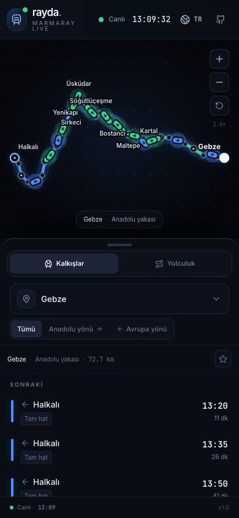

# Rayda — Istanbul rail, on one map

A timetable-driven map of Istanbul rail. It covers Marmaray and all 20 Metro İstanbul metro, tram, funicular and cable-car lines, and adds Metrobüs to journey planning. Rayda reconstructs every train from published timetables and inter-station run times. The result is a fast, installable dashboard with animated trains, station departure boards, and a journey planner with transfers.

**Open the app → [rayda.omerdikyol.com](https://rayda.omerdikyol.com)**


<p align="center">
  
</p>

## What it does

- **Network map**: every line and around 200 stations on a responsive SVG map, with each running train placed from the timetable. Pan, pinch, zoom, or tap a station or a train. A line filter shows or hides lines one at a time or by mode.
- **Station departures**: one board per line and destination, with minutes to the next train and the times after it. Filter by line and star favourite stations.
- **Journey planner**: pick stations from the list or from the map. Rayda finds the fastest journeys with transfers and walks between platforms, then animates the chosen route on the map. It also suggests other routes that arrive soon after the fastest one, such as Metrobüs across the bridge instead of changing at Yenikapı.
- **Metrobüs**: the Beylikdüzü – Söğütlüçeşme corridor (34G) is used in journeys and on departure boards. Its stop-to-stop times are estimates, so they are shown with a `~` and no buses are drawn.
- **Bilingual, light and dark**: Turkish and English, and light and dark themes. Both are remembered locally.
- **Installable PWA**: works offline after the first load and installs to the home screen.
- **Timezone-safe**: all timetables run on Istanbul local time (UTC+3), regardless of the device timezone.

## How the simulation works

Rayda has no real-time GPS feed. It is a **timetable simulation**, not an official tracker.

1. Each direction of a line runs either on a headway (Marmaray: first and last departure plus a frequency, with late-night service on weekends) or on an explicit timetable (metro, tram, Metrobüs: departures by weekday, Saturday and Sunday).
2. The schedule engine expands that into individual runs for every day, including overnight runs that started on the previous service day.
3. A run's elapsed time is mapped onto a precomputed route plan (per-segment run times and cumulative offsets). That gives the current segment, progress, coordinate, bearing and next-stop ETA.
4. Departure boards and the journey planner read the same schedule, so the map, boards and planner always agree. The planner runs a Connection Scan over the next eight hours, with walking links at interchanges. For alternatives, it plans again with one transfer stop or one line of the fastest route ruled out.

The engine is **stateless**: trains are derived from the clock on every tick. They cannot disappear after the app has been open for a while, and opening the app before the first train still shows the next service.

## Data

- Marmaray stations, coordinates and distances: the Istanbul Metropolitan Municipality (IMM) GTFS feed. Service windows and headways: the official Marmaray timetable.
- Metro, tram, funicular and cable-car lines: the IMM public transport GTFS feed (IMM Open Data Licence), converted by `scripts/import-metro.py` into `src/data/metro.ts`.
- Metrobüs: the IETT GTFS feed (IMM Open Data Licence), converted by `scripts/import-metrobus.py` into `src/data/metrobus.ts`. The feed only times the termini, so stop-to-stop times are estimated and shown with `~`; buses are not drawn on the map.
- Marmaray run times: directed times in [`src/data/interStationTimes.ts`](src/data/interStationTimes.ts), taken from the official timetable: 107 minutes Halkalı → Gebze, 108 minutes Gebze → Halkalı, 63 minutes Ataköy ↔ Pendik.

Times are estimates. Use Rayda to explore the network and plan around the timetable, not as an operational source during disruption.

## Development

```bash
npm install
npm run dev        # local development
npm run build      # typecheck + production build
npm run typecheck  # TypeScript only
npm run lint       # ESLint
npm test           # engine smoke checks
npm run preview    # preview the production build
```

No access token or API key is required.

The app is served from the root of [rayda.omerdikyol.com](https://rayda.omerdikyol.com) (GitHub Pages with a custom domain, `public/CNAME`).

### Tech stack

- React 19 + TypeScript 5.8
- Vite 7
- Tailwind CSS 4 with a small design-token theme
- Zustand for app state
- A custom responsive SVG map (no mapping SDK or tile provider)
- Lucide icons

### Project structure

```
src/
├── components/      UI: map, departures, journey planner, shell
├── contexts/        language + transit clock providers
├── data/            stations, routes, run times, network helpers
├── hooks/           clock hook
├── stores/          persisted app state
├── types/           domain types
└── utils/           schedule engine, geometry, time, formatting
```

The core of the product is [`src/utils/schedule.ts`](src/utils/schedule.ts). Start there.

## Contributing

Bug reports, data corrections, and UX feedback are welcome. The highest-value contributions are verified inter-station run times and station accessibility details.

- [Contributing guide](CONTRIBUTING.md)
- [Roadmap](ROADMAP.md)
- [Security policy](SECURITY.md)

## License

MIT — see [LICENSE](LICENSE).
