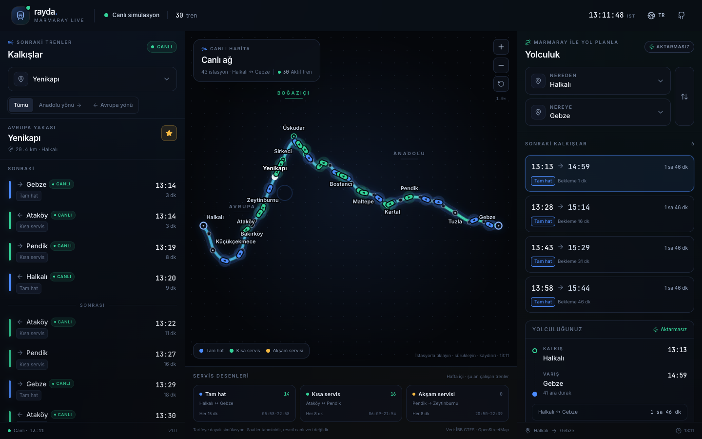

# Rayda — Marmaray, live.

A timetable-driven live map of Istanbul rail: Marmaray plus the metro, tram, funicular and cable-car lines. Rayda reconstructs every train from published timetables and inter-station run times, then turns that into a fast, installable dashboard: animated trains, station departure boards, and a journey planner with transfers.

**Open the app → [rayda.omerdikyol.com](https://rayda.omerdikyol.com)**



<p align="center">
  
</p>

## What it does

- **Live network map** — all 43 Marmaray stations on a responsive schematic map, with every active train positioned from the timetable. Pan, zoom, tap a station, or tap a train for its next stop and ETA.
- **Station departures** — the next trains from any station in both directions, with live/scheduled status, headway, and destination.
- **Journey planner** — pick an origin and destination and compare the next direct departures, waits, arrival times, and trip duration.
- **Bilingual** — full Turkish and English UI, remembered locally.
- **Installable PWA** — works offline after the first load and installs to the home screen.
- **Timezone-safe** — all timetables run on Istanbul local time (UTC+3), regardless of the device timezone.

## How the simulation works

No public real-time GPS feed is available for Marmaray, so Rayda is honest about what it is: a **timetable simulation**, not an official live tracker.

1. Each service pattern has a first and last departure from its origin terminus, a headway, and a direction.
2. The schedule engine expands that into individual runs for every day, including overnight runs from the previous service day.
3. A run's elapsed time is mapped onto a precomputed route plan (per-segment run times and cumulative offsets), producing the current segment, segment progress, coordinate, bearing, and next-stop ETA.
4. Station departures and journey options are read directly from the same schedule, so the map, boards, and planner can never disagree.

The engine is **stateless**: trains are derived from the clock on every tick. They cannot disappear after the app has been open for a while, and loading the app before the first train still shows the next service.

## Data

- Station names, coordinates, and distances: Istanbul Metropolitan Municipality GTFS.
- Service windows and headways: official Marmaray timetable data.
- Metro, tram, funicular and cable-car lines: the IMM public transport GTFS feed (IMM Open Data Licence), converted by `scripts/import-metro.py` into `src/data/metro.ts`.
- Inter-station run times: directed times in [`src/data/interStationTimes.ts`](src/data/interStationTimes.ts), taken from the official timetable: 107 minutes Halkalı → Gebze, 108 minutes Gebze → Halkalı, 63 minutes Ataköy ↔ Pendik.

Times are estimates. Use Rayda to explore the network and plan around the timetable, not as an operational source during disruption.

## Development

```bash
npm install
npm run dev        # local development
npm run build      # typecheck + production build
npm run typecheck  # TypeScript only
npm run lint       # ESLint
npm run preview    # preview the production build
```

No access token or API key is required.

The app is served from the root of [rayda.omerdikyol.com](https://rayda.omerdikyol.com) (GitHub Pages with a custom domain, `public/CNAME`).

### Tech stack

- React 19 + TypeScript 5.8
- Vite 7
- Tailwind CSS 4 with a small design-token theme
- Zustand for app state
- A custom responsive SVG map (no mapping SDK or tile provider)
- Lucide icons

### Project structure

```
src/
├── components/      UI: map, departures, journey planner, shell
├── contexts/        language + live transit providers
├── data/            stations, routes, run times, network helpers
├── hooks/           clock hook
├── stores/          persisted app state
├── types/           domain types
└── utils/           schedule engine, geometry, time, formatting
```

The core of the product is [`src/utils/schedule.ts`](src/utils/schedule.ts). Start there.

## Contributing

Bug reports, data corrections, and UX feedback are welcome. The highest-value contributions are verified inter-station run times and station accessibility details.

- [Contributing guide](CONTRIBUTING.md)
- [Roadmap](ROADMAP.md)
- [Security policy](SECURITY.md)

## License

MIT — see [LICENSE](LICENSE).
